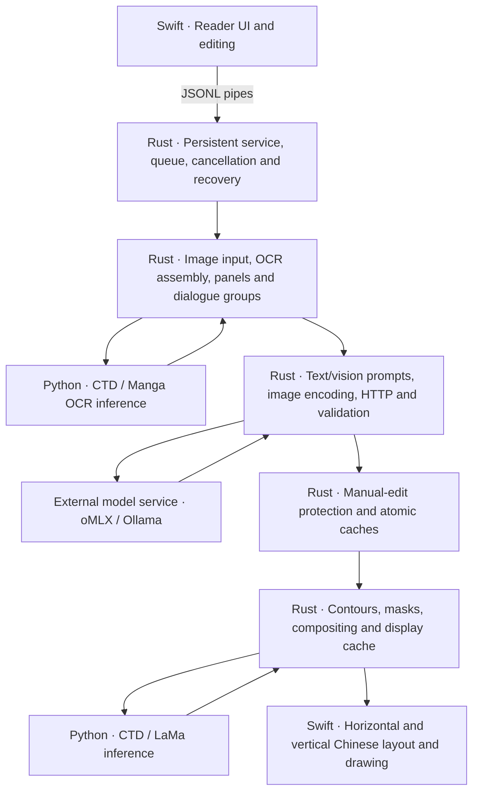

# Koma · Local Manga Translation

[简体中文](README.md) | English

Koma recognizes Japanese text in manga, translates it and typesets Chinese on the original page. The macOS reader on `main` uses a Rust core and a SwiftUI interface. Python runs the detection, OCR and background-restoration models. The Windows reader uses the original Python backend.

This guide covers the current source build. The macOS build is still named `Koma Rust 候选版.app` and depends on the checkout and its local runtime. The pre-migration Python reader is available at `stable/pre-rust-20261108`.

**November 18, 2026 · macOS reader update.** Build from `main` to adjust typography for individual dialogue boxes, reflow a page using saved translations, and drag the divider to resize the dialogue sidebar. [Update notes (Chinese)](docs/macos-typesetting-2026-11-18.md)

## Architecture



| Layer | Responsibilities |
| --- | --- |
| Swift / SwiftUI | Reader interaction, connection settings, horizontal and vertical Chinese layout and drawing |
| Rust / native libraries | Task control, OCR assembly, structure, HTTP, image codecs, persistence, cleanup/compositing and owned engine lifecycle |
| Python adapter | Installed CTD, Manga OCR and Anime LaMa inference, including model preprocessing/output conversion |
| oMLX / Ollama | Language or vision model serving; model inference was not rewritten in Rust |

Rust starts the Python inference adapter on demand and reuses it. It manages any local Ollama processes it starts. Users manage existing Ollama and oMLX services. See [core documentation](core/README.md).

## Run

Requires Apple Silicon, macOS 14+, Swift build tools, Rust/Cargo, native OpenCV 4.11.0, a prepared `macos/.venv`, and installed weights under `.models/`. Follow the [macOS setup guide](macos/README.en.md) for first-time preparation.

For daily use, double-click **[启动 Rust 候选版.command](启动%20Rust%20候选版.command)** at the repository root, or `macos/启动.command`. The launchers activate an existing window and build if app or core artifacts are missing or the checkout has moved. After updating existing source files, rebuild with the command below.

For development, from this branch's repository root:

```sh
./macos/scripts/build_and_run.sh --verify
# Open an existing build:
open 'macos/dist/Koma Rust 候选版.app'
```

The script builds and restarts only this checkout's candidate, then checks that it stays alive for 10 seconds. The double-click launcher uses `--open` to reuse an existing build without restarting the app. The build depends on the checkout and local runtime; rebuild after moving the repository.

Open an image folder, configure the endpoint, optional API key and model, and process a page or folder. Visual assistance requires an image-capable model served by oMLX. It combines the page image with existing OCR boxes; it does not recover undetected text by adding boxes.

Candidate data lives under `~/Library/Application Support/KomaReaderRust/`: `config.json`, `pages/`, `pages/vision-v1/` and `reading-native-v1/`. Stable configuration/pages may be copied read-only into independent candidate files on first use. Keys can be saved in the local plaintext config with mode `0600`; Keychain is not accessed. If key persistence is disabled, the key is session-only. Configs, images, weights and private evaluation artifacts are not committed.

For Windows, use the existing [Windows guide](windows/README.en.md); the Rust migration and measurements do not apply to that client.

## Features

- WebP, PNG, JPG, JPEG, BMP and TIFF, naturally sorted; original images remain read-only.
- The macOS reader supports single-page and chapter processing, individual retranslation, source and translation editing, and manual-edit protection. The bottom bar offers display modes, zoom, chapter thumbnails and page diagnostics for upscaling, OCR, translation and layout.
- Choose **Keep original bubble** in the dialogue editor to skip translation and typesetting for the detected bubble. Choose **Translate this bubble** to resume processing.
- **Export manga** saves the whole chapter or selected pages as local PNGs with their original chapter page numbers. Choose the destination and folder name. See the [macOS export guide](macos/README.en.md#export-manga).
- MetalFX and Real-CUGAN can upscale to 2560 or 3840 pixels by long edge or height. Changing enhancement settings reuses OCR, translations and manual edits within the selected translation mode. Real-CUGAN uses exact full-image feature synchronization to reduce color casts in dense screentones. See the [upscaling guide in Chinese](docs/macos-super-resolution.md).
- Separate text and vision caches; proposed OCR corrections require manual confirmation.
- Horizontal Chinese text wraps to the bubble contour using measured glyph widths, including long sentences in irregular or connected bubbles. Automatic layout can choose vertical text for tall, narrow regions. You can also set the direction for a chapter or an individual dialogue.
- Pixel masks and local background restoration replace broad white strips; narration is grouped in reading order.
- Display caches are separate from translations. When a translation cannot be typeset, the image is preserved, the dialogue pane retains the available translation and the bottom status area shows a notice.

## 35-page validation — November 8, 2026

Comparisons use the same 35 images and frozen translations as the stable baseline.

| Check | Result |
| --- | --- |
| Real OCR and page assembly | Identical structured output for 259 blocks |
| Final Swift rendering | All 35 pages pixel-identical; identical layout audits |
| Existing translations | 244 displayed; no new omissions, glyph crossings or text loss |
| Text / vision translation pipelines | 209 / 100 differential scenarios passed with simulated model replies |
| Vision image encoding | Identical JPEG bytes for 35 pages and 56 format/size/orientation cases |
| Controller / real-window flows | 8 / 6 scenarios passed; actual app startup crash separately fixed and verified |
| Native foundations and lifecycle | 11 tests passed; all 35 display caches reused after service restart |

The remaining 15 blocks follow existing skip/preservation rules. Original image and translation-cache hashes are unchanged. Pages 13 and 15 were visually reviewed for narration, long sentences and irregular bubbles, with no regression against the baseline.

| Display-processing metric | Stable Python | Rust candidate |
| --- | ---: | ---: |
| First generation of 35 pages, including service startup | 98.035 s | 47.243 s |
| 105 cache hits, total | 13.259 s | 0.751 s |
| Median cache-hit time per page | 125.49 ms | 6.54 ms |

First generation is about 2.1× faster in this run. Gains include persistent processes and cache reuse, not just language choice. Timing excludes UI drawing; OS file caches were not forcibly cleared. **These are display measurements, not OCR/LLM inference speed or translation-quality improvements.** Memory measurements use different methods and do not establish lower memory usage; resident models retain memory.

See the [validation report](docs/rust-core-validation.md), [migration record](docs/rust-core-migration.md) and [November 7–8 progress](进度汇总/07_填充修复与Rust重构_2026-11-08/当前进度_2026-11-08.md) for methods and evidence from the migration build.

## Limits and repository layout

Parity on 35 pages does not establish universal correctness. OCR omissions, handwriting, names/dates and translation semantics still need review; restoration may leave texture artifacts. This migration preserved existing source text and translations without content corrections.

Windows continues to use the original reader. Manual box editing, cross-page character memory, glossaries, ZIP/PDF input and recursive subfolders remain outside the current feature set.

```text
core/                   Rust core, native bridge and Python model adapter
macos/                  Swift UI, candidate build and model environment
windows/                Original Python Windows reader
backend/                Original backend retained for stable/reference use
tools/rust_migration/    Build tools and offline core regressions
scripts/                Model preparation, cache migration and regression runner
docs/                   Architecture, migration and validation
进度汇总/                Current progress and dated historical records
```

Upstream components include [Mokuro](https://github.com/kha-white/mokuro), [Manga OCR](https://github.com/kha-white/manga-ocr), [Comic Text Detector](https://github.com/dmMaze/comic-text-detector), [IOPaint / Anime LaMa](https://github.com/Sanster/IOPaint), [OpenCV](https://github.com/opencv/opencv) and [Ollama](https://github.com/ollama/ollama), under their respective licenses. See [native third-party notices](core/THIRD_PARTY.md) for image compatibility code and the Pillow license. Weights and dependencies are not included in Git.
