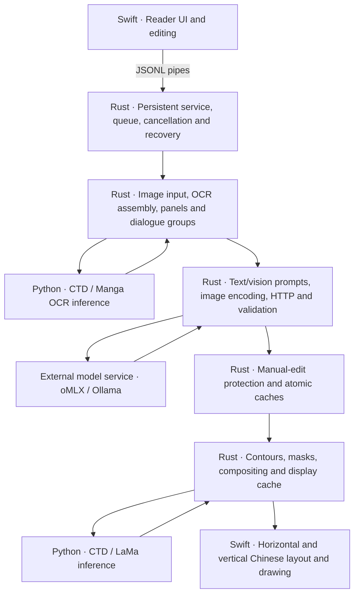

# Koma for macOS

[简体中文](README.md) | English

Koma recognizes Japanese dialogue on an Apple Silicon Mac, translates it and typesets Chinese on the original manga page. This repository maintains the Mac reader, Rust core and Python model adapter.

## Download

**[Download Koma v2.3 for macOS (ZIP)](https://github.com/Liuyy026/screen-capture-translator-public/releases/download/v2.3/Koma-2.3-macOS-arm64.zip)** · [SHA-256 checksum](https://github.com/Liuyy026/screen-capture-translator-public/releases/download/v2.3/SHA256SUMS.txt) · [v2.3 release page](https://github.com/Liuyy026/screen-capture-translator-public/releases/tag/v2.3)

Requires Apple Silicon and macOS 14 or later. Unzip and open `Koma.app` to read a chapter or try the sample pages. Quit the app and run the included `准备组件.command` to install OCR, restoration and Real-CUGAN components. The release app continues to use existing settings and caches in `KomaReaderRelease`. [Package instructions (Chinese)](macos/release/README.md)

In v2.3 you can choose ordinary or vision-assisted translations for each export. The reader checks the selected pages and shows differing manual translations saved in the other mode. Select a missed area to correct its OCR, or move and resize a Chinese text frame before saving the chapter as PNGs. [Mac reader guide](macos/README.en.md)

The previous download remains on the [macOS v0.22 release page](https://github.com/Liuyy026/screen-capture-translator-public/releases/tag/v0.22). See [Run from source](#run-from-source) for build instructions.

Find the legacy Windows source and setup instructions in [Koma-Windows-Legacy](https://github.com/Liuyy026/Koma-Windows-Legacy) and the [Windows validation guide (Chinese)](https://github.com/Liuyy026/Koma-Windows-Legacy/blob/main/Windows%E5%AE%9E%E6%9C%BA%E9%AA%8C%E8%AF%81.md).

## Architecture



| Layer | Responsibilities |
| --- | --- |
| Swift / SwiftUI | Reader interaction, connection settings, horizontal and vertical Chinese layout and drawing |
| Rust / native libraries | Task control, OCR assembly, structure, HTTP, image codecs, persistence, cleanup/compositing and owned engine lifecycle |
| Python adapter | Installed CTD, Manga OCR and Anime LaMa inference, including model preprocessing/output conversion |
| oMLX / Ollama | Language or vision model serving; model inference was not rewritten in Rust |

Rust starts the Python inference adapter on demand and reuses it. It manages any local Ollama processes it starts. Users manage existing Ollama and oMLX services. See [core documentation](core/README.md).

## Run from source

Requires Apple Silicon, macOS 14+, Swift build tools, Rust/Cargo, native OpenCV 4.11.0, a prepared `macos/.venv`, and installed weights under `.models/`. Follow the [macOS setup guide](macos/README.en.md) for first-time preparation.

For daily use, double-click **[启动 Koma.command](启动%20Koma.command)** at the repository root, or `macos/启动.command`. The launchers activate an existing window and build if app or core artifacts are missing or the checkout has moved. After updating existing source files, rebuild with the command below.

For development, from this branch's repository root:

```sh
./macos/scripts/build_and_run.sh --verify
# Open an existing build:
open macos/dist/Koma.app
```

The script builds and restarts only this checkout's Koma app, then checks that it stays alive for 10 seconds. The double-click launcher uses `--open` to reuse an existing build. Rebuild after moving the repository so the app can find its local runtime.

Open an image folder, configure the endpoint, optional API key and model, and process a page or folder. Visual assistance combines manga images with existing OCR text and translates within the detected text boxes.

The source build stores its data under `~/Library/Application Support/KomaReaderRust/`. This includes `config.json`, `pages/`, `pages/vision-v1/` and `reading-native-v1/`. On first use, the app can copy settings and pages from the older `KomaReader` data directory. Keys can be saved in the local plaintext config with mode `0600`; Keychain is not accessed. If key persistence is disabled, the key is session-only. Configs, images, weights and private evaluation artifacts are not committed.

### Release translation models

Mac builds from the current `main` branch can unload translation models from oMLX and Ollama. While you translate consecutive pages, Koma keeps the model loaded for the next page.

- **Release a model manually.** After translation finishes, open Processing Settings (处理设置) and click **释放当前模型** (Release current model) next to **刷新模型** (Refresh models). Your selection stays in place. Koma loads the model again the next time a page needs translation. If unloading fails, click **重试释放** (Retry release).
- **Automatic unloading.** When you switch models or services, Koma asks the previous service to unload the model used in this session. When you quit Koma or close the last reader window, Koma requests an unload for any remaining models it used and waits for the service to respond before exiting.

Clients using the same oMLX server share models. Unloading a model can interrupt another application's request if it is using that same model.

## Features

- WebP, PNG, JPG, JPEG, BMP and TIFF, naturally sorted; original images remain read-only.
- The macOS reader supports single-page and chapter processing, individual retranslation, source and translation editing, and manual-edit protection. The bottom bar offers display modes, zoom, chapter thumbnails and page diagnostics for upscaling, OCR, translation and layout.
- Choose **Keep original bubble** in the dialogue editor to skip translation and typesetting for the detected bubble. Choose **Translate this bubble** to resume processing.
- **Export manga** saves the whole chapter or selected pages as local PNGs with their original chapter page numbers. Choose the destination and folder name. See the [macOS export guide](macos/README.en.md#export-manga).
- MetalFX and Real-CUGAN can upscale to 2560 or 3840 pixels by long edge or height. Changing enhancement settings reuses OCR, translations and manual edits within the selected translation mode. Real-CUGAN uses exact full-image feature synchronization to reduce color casts in dense screentones. See the [upscaling guide in Chinese](docs/macos-super-resolution.md).
- Separate text and vision caches; proposed OCR corrections require manual confirmation.
- Horizontal Chinese text wraps to the bubble contour using measured glyph widths, including long sentences in irregular or connected bubbles. Automatic layout can choose vertical text for tall, narrow regions. You can also set the direction for a chapter or an individual dialogue.
- Pixel masks and local background restoration replace broad white strips; narration is grouped in reading order.
- Display caches are separate from translations. When a translation cannot be typeset, the image is preserved, the dialogue pane retains the available translation and the bottom status area shows a notice.

## 35-page validation — November 8, 2026

Comparisons use the same 35 images and frozen translations as the stable baseline.

| Check | Result |
| --- | --- |
| Real OCR and page assembly | Identical structured output for 259 blocks |
| Final Swift rendering | All 35 pages pixel-identical; identical layout audits |
| Existing translations | 244 displayed; no new omissions, glyph crossings or text loss |
| Text / vision translation pipelines | 209 / 100 differential scenarios passed with simulated model replies |
| Vision image encoding | Identical JPEG bytes for 35 pages and 56 format/size/orientation cases |
| Controller / real-window flows | 8 / 6 scenarios passed; actual app startup crash separately fixed and verified |
| Native foundations and lifecycle | 11 tests passed; all 35 display caches reused after service restart |

The remaining 15 blocks follow existing skip/preservation rules. Original image and translation-cache hashes are unchanged. Pages 13 and 15 were visually reviewed for narration, long sentences and irregular bubbles, with no regression against the baseline.

| Display-processing metric | Stable Python | Rust candidate |
| --- | ---: | ---: |
| First generation of 35 pages, including service startup | 98.035 s | 47.243 s |
| 105 cache hits, total | 13.259 s | 0.751 s |
| Median cache-hit time per page | 125.49 ms | 6.54 ms |

First generation is about 2.1× faster in this run. Gains include persistent processes and cache reuse, not just language choice. Timing excludes UI drawing; OS file caches were not forcibly cleared. **These are display measurements, not OCR/LLM inference speed or translation-quality improvements.** Memory measurements use different methods and do not establish lower memory usage; resident models retain memory.

See the [validation report](docs/rust-core-validation.md), [migration record](docs/rust-core-migration.md) and [November 7–8 progress](进度汇总/07_填充修复与Rust重构_2026-11-08/当前进度_2026-11-08.md) for methods and evidence from the migration build.

## Limits and repository layout

Parity on 35 pages does not establish universal correctness. OCR omissions, handwriting, names/dates and translation semantics still need review; restoration may leave texture artifacts. This migration preserved existing source text and translations without content corrections.

Manual box editing, cross-page character memory, glossaries, ZIP/PDF input and recursive subfolders remain outside the current feature set.

```text
core/                   Rust core, native bridge and Python model adapter
macos/                  Swift UI, app build and model environment
tools/rust_migration/    Build tools and offline core regressions
scripts/                Model preparation, cache migration and regression runner
docs/                   Architecture, migration and validation
进度汇总/                Current progress and dated historical records
```

Upstream components include [Mokuro](https://github.com/kha-white/mokuro), [Manga OCR](https://github.com/kha-white/manga-ocr), [Comic Text Detector](https://github.com/dmMaze/comic-text-detector), [IOPaint / Anime LaMa](https://github.com/Sanster/IOPaint), [OpenCV](https://github.com/opencv/opencv) and [Ollama](https://github.com/ollama/ollama), under their respective licenses. See [native third-party notices](core/THIRD_PARTY.md) for image compatibility code and the Pillow license. Weights and dependencies are not included in Git.

## Manga translation benchmark

Japanese-to-Chinese translation on a Mac Studio (M5 Max, 64 GB) with Koma v0.22, macOS 27.0.1 and oMLX 0.7.3, tested on November 21, 2026. The two 4-bit models were `Qwen3.5-9B-The-Defiant-Fable-Uncensored-Heretic-MLX-4bit` (9B) and `Qwen3.8-27B-Uncensored-MLX-4bit` (27B).

| Model | Images sent | Total for 10 pages | Median per page | Generation (tokens/s) | Delivered after recheck / 81 | Rated faithful / 79 |
|---|---|---:|---:|---:|---:|---:|
| 9B | Current page | 37.89 s | 3.64 s | 73.45 | 34/81 | 22/79 |
| 9B | Previous + current | 59.90 s | 5.03 s | 72.14 | 76/81 | 49/79 |
| 27B | Current page | 93.08 s | 7.80 s | 26.75 | 81/81 | 67/79 |
| 27B | Previous + current | 140.15 s | 10.80 s | 26.52 | 81/81 | 70/79 |

**Why did the count change from 46/81 to 34/81?** In the 9B current-page run, v0.22 rejected 35 of the 81 outputs for repeating the Japanese source. We rechecked the saved outputs from all four runs with the updated validator. Of the 46 blocks originally counted as delivered in this run, 12 copied the Japanese text and changed only the punctuation. Excluding them brings the count to 34/81. All 22 blocks originally rated faithful still passed, and the delivery counts for the other three runs matched the original results. Timings, generation speeds and blind ratings all come from the original v0.22 benchmark.

With the current page alone, 9B took 59.3% less time than 27B. Adding the previous page cost 9B an average of 2.20 s per page and raised delivery from 34/81 to 76/81. For 27B, the extra image cost 4.71 s per page on average, with 81/81 delivered in both modes. With both images, 9B took 57.3% less time than 27B.

**Method.** All four runs used the same five pages from each of two manga, with frozen OCR, coordinates and target blocks. In the two-image mode, Koma sent the previous page first and translated only the current page. Each model was loaded separately and warmed up. Each page was timed once per mode, alternating which mode ran first. Timing included image encoding, the local model request and translation parsing. Model loading, OCR, upscaling, display layout and export were outside the timed interval. Generation speed is total output tokens divided by total decoding time. Both models had the same input-cache hit rates, 21.9% with one image and 5.1% with two.

Thinking and DFlash were disabled, temperature was 0.15 and the output limit was 8,192 tokens. In each run, JSON Schema constraints were active for all 14 batches, every batch stopped normally and the reasoning-token count was zero. Delivery counts nonempty translations accepted by Koma. Model-assisted reviewers compared outputs against the images with model and mode hidden. The 79-block fidelity denominator excludes two OCR detections on background art and includes undelivered translations. A faithful rating requires preserving meaning and references in context. Timing in this single-pass sample depends on input-cache hits and generated output length.
