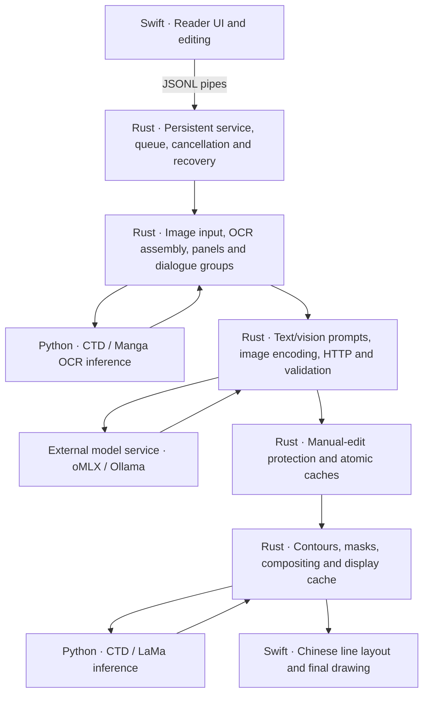

# Koma · Local Manga Translation (Rust candidate)

[简体中文](README.md) | English

Local Japanese manga OCR, translation and Chinese typesetting. **This is the independent `refactor/rust-core` development branch.** The macOS business core now runs in Rust; Swift retains the UI and Chinese layout, while Python runs detection, OCR and background-restoration models. The Windows reader still uses the original Python backend.

The stable version remains on [`main`](https://github.com/Liuyy026/screen-capture-translator-public/tree/main). The frozen pre-migration baseline is `a08b421` / `stable/pre-rust-20261108`. The candidate has a separate app identity, configuration and caches; it has not been merged into stable and is not a standalone distribution package.

## Architecture



| Layer | Responsibilities |
| --- | --- |
| Swift / SwiftUI | Reader interaction, connection settings, left-to-right Chinese layout and drawing |
| Rust / native libraries | Task control, OCR assembly, structure, HTTP, image codecs, persistence, cleanup/compositing and owned engine lifecycle |
| Python adapter | Installed CTD, Manga OCR and Anime LaMa inference, including model preprocessing/output conversion |
| oMLX / Ollama | Language or vision model serving; model inference was not rewritten in Rust |

The candidate does not invoke the old Python business workers. Rust lazily starts and reuses the inference adapter and only manages local Ollama processes it owns. Existing services and oMLX are not taken over. See [core documentation](core/README.md).

## Run

Requires Apple Silicon, macOS 14+, Swift build tools, Rust/Cargo, native OpenCV 4.11.0, a prepared `macos/.venv`, and installed weights under `.models/`. Follow the [macOS setup guide](macos/README.en.md) for first-time preparation.

From this branch's repository root:

```sh
./macos/scripts/build_and_run.sh --verify
# Open an existing build:
open 'macos/dist/Koma Rust 候选版.app'
```

The script builds and restarts only this checkout's candidate, then checks that it stays alive for 10 seconds. Do not use the legacy `macos/启动.command`: it still targets the stable app name. The build depends on the checkout and local runtime; rebuild after moving the repository.

Open an image folder, configure the endpoint, optional API key and model, and process a page or folder. Visual assistance requires an image-capable model served by oMLX. It combines the page image with existing OCR boxes; it does not recover undetected text by adding boxes.

Candidate data lives under `~/Library/Application Support/KomaReaderRust/`: `config.json`, `pages/`, `pages/vision-v1/` and `reading-native-v1/`. Stable configuration/pages may be copied read-only into independent candidate files on first use. Keys can be saved in the local plaintext config with mode `0600`; Keychain is not accessed. If key persistence is disabled, the key is session-only. Configs, images, weights and private evaluation artifacts are not committed.

For Windows, use the existing [Windows guide](windows/README.en.md); the Rust migration and measurements do not apply to that client.

## Features

- WebP, PNG, JPG, JPEG, BMP and TIFF, naturally sorted; original images remain read-only.
- macOS page/folder processing, cancellation, individual retranslation, source/translation editing and manual-edit protection.
- Separate text and vision caches; proposed OCR corrections require manual confirmation.
- Left-to-right Chinese text with measured glyph widths and contour-aware lines for long sentences and irregular/connected bubbles.
- Pixel masks and local background restoration replace broad white strips; narration is grouped in reading order.
- Display caches are separate from translations. Unsafe layouts preserve the image and show the full translation and reason in the sidebar.

## 35-page validation — November 8, 2026

Comparisons use the same 35 images and frozen translations as the stable baseline.

| Check | Result |
| --- | --- |
| Real OCR and page assembly | Identical structured output for 259 blocks |
| Final Swift rendering | All 35 pages pixel-identical; identical layout audits |
| Existing translations | 244 displayed; no new omissions, glyph crossings or text loss |
| Text / vision translation pipelines | 209 / 100 differential scenarios passed with simulated model replies |
| Vision image encoding | Identical JPEG bytes for 35 pages and 56 format/size/orientation cases |
| Controller / real-window flows | 8 / 6 scenarios passed; actual app startup crash separately fixed and verified |
| Native foundations and lifecycle | 11 tests passed; all 35 display caches reused after service restart |

The remaining 15 blocks follow existing skip/preservation rules. Original image and translation-cache hashes are unchanged. Pages 13 and 15 were visually reviewed for narration, long sentences and irregular bubbles, with no regression against the baseline.

| Display-processing metric | Stable Python | Rust candidate |
| --- | ---: | ---: |
| First generation of 35 pages, including service startup | 98.035 s | 47.243 s |
| 105 cache hits, total | 13.259 s | 0.751 s |
| Median cache-hit time per page | 125.49 ms | 6.54 ms |

First generation is about 2.1× faster in this run. Gains include persistent processes and cache reuse, not just language choice. Timing excludes UI drawing; OS file caches were not forcibly cleared. **These are display measurements, not OCR/LLM inference speed or translation-quality improvements.** Memory measurements use different methods and do not establish lower memory usage; resident models retain memory.

See the [validation report](docs/rust-core-validation.md), [migration record](docs/rust-core-migration.md) and [November 7–8 progress](进度汇总/当前进度_2026-11-08.md) for methods, reproducibility entry points and local evidence locations. This documentation update reports completed validation; it does not rerun model benchmarks.

## Limits and repository layout

Parity on 35 pages does not establish universal correctness. OCR omissions, handwriting, names/dates and translation semantics still need review; restoration may leave texture artifacts. This migration preserved existing source text and translations without content corrections.

Standalone packaging, broader long-term testing and a Windows Rust integration remain unfinished. Manual box editing, cross-page character memory, glossaries, in-app translated-image export, ZIP/PDF input and recursive subfolders are outside this delivery. Test rendering tools are not an in-app export feature.

```text
core/                   Rust core, native bridge and Python model adapter
macos/                  Swift UI, candidate build and model environment
windows/                Original Python Windows reader
backend/                Original backend retained for stable/reference use
tools/rust_migration/    Build, differential validation and benchmark tools
scripts/ tests/          Original model preparation, evaluation and tests
docs/                   Architecture, migration and validation
进度汇总/                Current progress and dated historical records
```

Upstream components include [Mokuro](https://github.com/kha-white/mokuro), [Manga OCR](https://github.com/kha-white/manga-ocr), [Comic Text Detector](https://github.com/dmMaze/comic-text-detector), [IOPaint / Anime LaMa](https://github.com/Sanster/IOPaint), [OpenCV](https://github.com/opencv/opencv) and [Ollama](https://github.com/ollama/ollama), under their respective licenses. See [native third-party notices](core/THIRD_PARTY.md) for image compatibility code and the Pillow license. Weights and dependencies are not included in Git.
