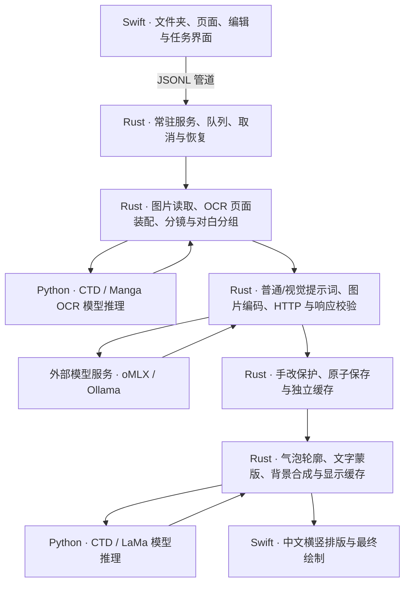

# Koma for macOS

简体中文 | [English](README.en.md)

Koma 在 Apple 芯片 Mac 上识别日文漫画、翻译对白并将中文排回原页。这个仓库维护 Mac 阅读器、Rust 核心和必要的 Python 模型适配器。Windows 旧版独立保存在 `Koma-Windows-Legacy`。

**本地版本 0.22** 适用于 Apple Silicon 和 macOS 14 及以上。双击解压后的 `Koma.app` 即可阅读或尝试内置样图。首次使用 OCR、修补和 Real-CUGAN 时，退出应用，运行 ZIP 里的 `准备组件.command`。正式应用继续使用 `KomaReaderRelease` 的已有配置和缓存。[随包使用说明](macos/release/README.md)

0.22 可以在同一整章任务中复用 OCR 模型，并在切页、编辑、导出和取消时保护页面缓存与手改内容。视觉辅助从第 3 页起同时参考同章上一页，只翻译当前页；逐框排版、选择页码导出和两种超分继续可用。[Mac 操作手册](macos/README.md)

本地构建包位于 `dist/v0.22/`。已公开的上一版仍可从 [v0.21 发布页](https://github.com/Liuyy026/screen-capture-translator-public/releases/tag/v0.21) 下载。

## 当前架构



| 层 | 当前职责 |
| --- | --- |
| Swift / SwiftUI | 阅读窗口、交互、连接设置、中文横竖排版与绘制 |
| Rust / 原生库 | 队列与取消、OCR 结果装配、结构分析、HTTP、图片编解码、缓存、清字与合成、自有引擎进程管理 |
| Python 模型适配器 | 已安装 CTD、Manga OCR、Anime LaMa 的推理及必要预处理/输出转换 |
| oMLX / Ollama | 语言或视觉模型服务；模型推理本身没有重写为 Rust |

Rust 按需启动和复用 Python 推理进程，并管理自己启动的本地 Ollama。已有 Ollama 和 oMLX 服务由用户管理。详细边界见 [核心说明](core/README.md)。

## 运行方式

要求 Apple Silicon、macOS 14+、Swift 编译工具、Rust/Cargo、原生 OpenCV 4.11.0，以及已准备好的 `macos/.venv` 和 `.models/`。**首次准备请按 [macOS 运行指南](macos/README.md) 完成依赖和模型安装**。

日常使用双击仓库根目录的 **[启动 Rust 候选版.command](启动%20Rust%20候选版.command)**，或 `macos/启动.command`。已运行时切回现有窗口，缺少应用或核心构建产物、仓库移动时自动构建。更新现有源码后，运行下面的开发命令重新构建。

开发时在本分支仓库根目录执行：

```sh
# 构建、启动候选版，并检查启动后持续存活 10 秒
./macos/scripts/build_and_run.sh --verify

# 已构建后直接打开
open 'macos/dist/Koma Rust 候选版.app'
```

`--verify` 只重启此 checkout 的候选应用；双击入口使用 `--open`，直接打开已有构建。构建产物依赖仓库路径及本机环境，移动仓库后需重新构建。

打开图片文件夹，在接口设置中保存服务地址、可选 Key 和模型，选择「普通翻译」或「视觉辅助」，再执行单页或整文件夹处理。视觉辅助结合漫画图像和已有 OCR 文字，翻译范围由已有文字框决定。

候选数据位于 `~/Library/Application Support/KomaReaderRust/`：`config.json` 保存连接配置，`pages/` 保存普通结果，`pages/vision-v1/` 保存视觉结果，`reading-native-v1/` 保存显示资产。首次可只读复制稳定版的配置和页面到独立副本。Key 可保存在权限 `0600` 的本地明文配置中，不访问钥匙串；不勾选保存 Key 时仅供本次运行使用。配置、原图、模型及私人评测工件不提交到 Git。


## 功能与显示效果

- 支持 WebP、PNG、JPG、JPEG、BMP、TIFF，原图只读，按文件名自然排序。
- macOS 支持单页和整章处理、单句重译、原文和译文编辑及手改保护。底部可切换显示和缩放、展开章节缩略图或收起对白栏。「本页诊断」汇总超分、识别、翻译与回填状态。
- 在右侧对白编辑区选择「保留原框」，可让整个已识别气泡保留原样，跳过翻译与回填。切回「翻译此框」可恢复处理。
- 「导出漫画」可将整章或指定页码合成为本地 PNG，保留章节原有页码。可指定保存位置与文件夹名称。操作方法见 [macOS 使用指南](macos/README.md#导出漫画)。
- 「处理设置」可启用 MetalFX 或 Real-CUGAN，支持按长边或高度放大到 2560 或 3840 像素。切换增强设置会复用同一翻译方式下的 OCR、译文和手工修改。Real-CUGAN 使用精确的全图特征同步，减少密集网点漫画偏色。参见 [超分说明](docs/macos-super-resolution.md)。
- 普通与视觉翻译分别缓存；画面复核建议需人工确认保存，不能自动改写日文。
- 中文横排按实际字宽和气泡轮廓换行，支持长句、相连或异形气泡及矩形旁白。窄长的日文竖排区域可自动改用中文竖排，也可在对白栏指定方向。
- 按文字像素蒙版清字，局部修补网点和复杂背景，连续旁白按顺序合并，不再铺整条白底。
- 显示与翻译缓存分开，已有译文可直接重新排版。无法回填时保留原图，在对白栏提供已有译文，并在底部状态区提示。

## 35 页对照结果（2026-11-08）

固定相同 35 页原图和既有译文，与重构前稳定版比较：

| 检查 | 结果 |
| --- | --- |
| 真实 OCR 与页面组装 | 259 个文字块及结构化结果一致 |
| 最终 Swift 整页渲染 | 35 页逐像素一致，布局审计一致 |
| 已有译文 | 244 段显示，新增漏排、字形越界、文字丢失均为 0 |
| 普通 / 视觉翻译流程 | 209 / 100 个差分场景通过，使用模拟模型回复 |
| 视觉输入图片 | 35 页及 56 个格式/尺寸/方向案例，JPEG 字节一致 |
| 控制器 / 真实窗口 | 8 / 6 项流程通过；另验证正式应用启动崩溃修复 |
| 原生基础与进程生命周期 | 11 项测试通过；重启服务后 35 页显示缓存全部命中 |

其余 15 个 OCR 块遵循既有跳过/保留规则，不算新增漏填。固定原图和原始译文缓存哈希未改变。第 13/15 页旁白、长句与异形气泡目视复核无相对基线回退。

| 显示处理指标 | Python 稳定版 | Rust 候选版 |
| --- | ---: | ---: |
| 35 页首次生成，含服务启动 | 98.035 秒 | 47.243 秒 |
| 缓存命中 105 次总计 | 13.259 秒 | 0.751 秒 |
| 缓存命中单页中位数 | 125.49 毫秒 | 6.54 毫秒 |

整章首次显示生成约快 2.1 倍。收益包含常驻进程和缓存复用，不能全部归因于 Rust。计时不含界面绘制，未强制清空系统文件缓存；**不是 OCR 或语言模型推理提速测试，也不是新一轮翻译质量评测**。内存统计口径不同，不能宣称内存降低；常驻模型会持续占用内存。

完整方法、测试入口及本地证据索引见 [验收报告](docs/rust-core-validation.md)、[迁移记录](docs/rust-core-migration.md) 和 [当时的进度](进度汇总/07_填充修复与Rust重构_2026-11-08/当前进度_2026-11-08.md)。这些数据对应迁移时的构建。

## 限制与后续

35 页一致性验收证明重构保留这组输入的效果，不能证明所有漫画均正确。OCR 漏字、手写字、姓名/日期错误与翻译语义问题仍需核对；背景修补也可能留有纹理痕迹。本轮保留原识别与译文，未混入内容校正。

手动补框和拆框、跨页人物记忆、术语表、ZIP/PDF 输入与递归子目录仍待实现。

## 目录与许可证

```text
core/                   Rust 核心、原生桥与 Python 模型适配器
macos/                  Swift 界面、候选构建及模型环境
tools/rust_migration/   Rust 构建及离线核心回归
scripts/                模型准备、缓存迁移及回归入口
docs/                   架构、迁移和验收记录
进度汇总/               当前进度与分日期历史归档
```

使用 [Mokuro](https://github.com/kha-white/mokuro)、[Manga OCR](https://github.com/kha-white/manga-ocr)、[Comic Text Detector](https://github.com/dmMaze/comic-text-detector)、[IOPaint / Anime LaMa](https://github.com/Sanster/IOPaint)、[OpenCV](https://github.com/opencv/opencv)、[Ollama](https://github.com/ollama/ollama) 等上游组件，各自遵循其许可证。Rust 图片兼容实现的来源与 Pillow 许可见 [第三方说明](core/THIRD_PARTY.md)。模型和依赖不纳入 Git。
