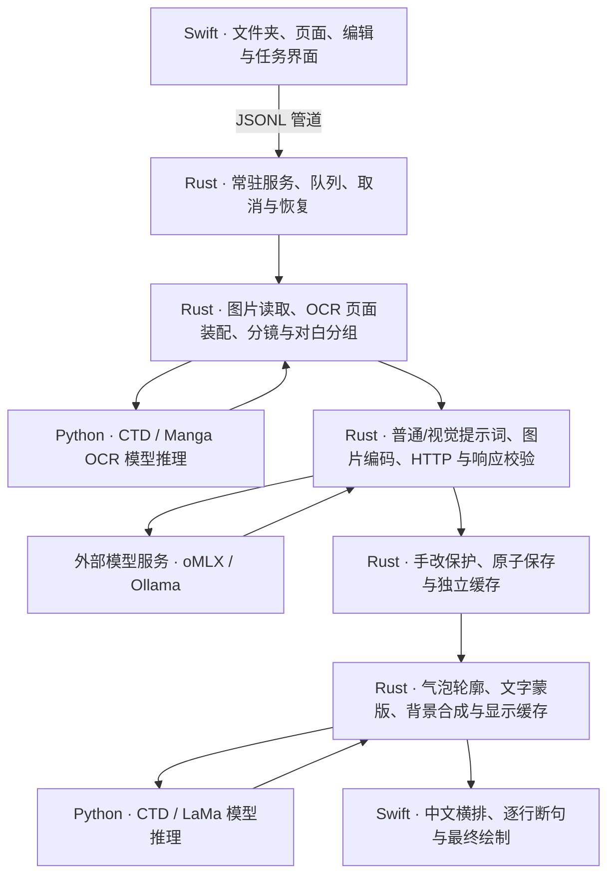

# Koma · 本地漫画翻译（Rust 候选版）

简体中文 | [English](README.en.md)

本地日文漫画识别、翻译与中文回填。**当前为 `refactor/rust-core` 独立开发分支**：macOS 业务核心已迁入 Rust，保留 SwiftUI 界面与中文排版，Python 仅承担检测、OCR 和背景修补模型推理。Windows 仍使用原 Python 后端，本轮没有迁移。

稳定版位于 [`main`](https://github.com/Liuyy026/screen-capture-translator-public/tree/main)，重构前基线为 `a08b421` / `stable/pre-rust-20261108`。候选应用、配置和缓存独立，尚未合并到稳定版，也不是可脱离项目目录分发的安装包。

## 当前架构



| 层 | 当前职责 |
| --- | --- |
| Swift / SwiftUI | 阅读窗口、交互、连接设置、中文从左到右/从上到下排版与绘制 |
| Rust / 原生库 | 队列与取消、OCR 结果装配、结构分析、HTTP、图片编解码、缓存、清字与合成、自有引擎进程管理 |
| Python 模型适配器 | 已安装 CTD、Manga OCR、Anime LaMa 的推理及必要预处理/输出转换 |
| oMLX / Ollama | 语言或视觉模型服务；模型推理本身没有重写为 Rust |

候选版不通过 Rust 调用旧 Python 业务 worker。Python 推理进程按需启动和复用；Rust 只管理自己启动的本地 Ollama，已有服务及 oMLX 不被接管。详细边界见 [核心说明](core/README.md)。

## 运行方式

要求 Apple Silicon、macOS 14+、Swift 编译工具、Rust/Cargo、原生 OpenCV 4.11.0，以及已准备好的 `macos/.venv` 和 `.models/`。**首次准备请按 [macOS 运行指南](macos/README.md) 完成依赖和模型安装**。

日常使用双击仓库根目录的 **[启动 Rust 候选版.command](启动%20Rust%20候选版.command)**，或 `macos/启动.command`。两者都只打开候选版；已运行时切回现有窗口，缺少应用/核心构建产物或仓库移动后才自动构建。首次仍需准备上述依赖。

开发时在本分支仓库根目录执行：

```sh
# 构建、启动候选版，并检查启动后持续存活 10 秒
./macos/scripts/build_and_run.sh --verify

# 已构建后直接打开
open 'macos/dist/Koma Rust 候选版.app'
```

`--verify` 只重启此 checkout 的候选应用；双击入口使用 `--open`，直接打开已有构建。构建产物依赖仓库路径及本机环境，移动仓库后需重新构建。

打开图片文件夹，在接口设置中保存服务地址、可选 Key 和模型，选择「普通翻译」或「视觉辅助」，再执行单页或整文件夹处理。视觉辅助要求 oMLX 中已有支持图片的模型；整页图片与既有 OCR 一起参与翻译，不会自动为漏检文字补框。

候选数据位于 `~/Library/Application Support/KomaReaderRust/`：`config.json` 保存连接配置，`pages/` 保存普通结果，`pages/vision-v1/` 保存视觉结果，`reading-native-v1/` 保存显示资产。首次可只读复制稳定版的配置和页面到独立副本。Key 可保存在权限 `0600` 的本地明文配置中，不访问钥匙串；不勾选保存 Key 时仅供本次运行使用。配置、原图、模型及私人评测工件不提交到 Git。

Windows 使用方法仍见 [Windows 说明](windows/README.md)，不能将其功能与性能视为已经迁入 Rust。

## 功能与显示效果

- macOS 候选版支持前置可选超分：MetalFX / Real-CUGAN、1440/2160 目标尺寸；原图只读，增强图的识别、翻译和显示使用独立缓存。使用与实测限制见 [前置超分说明](docs/macos-super-resolution.md)。

- 支持 WebP、PNG、JPG、JPEG、BMP、TIFF，原图只读，按文件名自然排序。
- macOS 支持单页/文件夹处理、取消、单句重译、原文/译文编辑及手改保护。
- 普通与视觉翻译分别缓存；画面复核建议需人工确认保存，不能自动改写日文。
- 中文横排按实际字宽和气泡轮廓换行；处理长句、相连/异形气泡及矩形旁白。
- 按文字像素蒙版清字，局部修补网点和复杂背景，连续旁白按顺序合并，不再铺整条白底。
- 显示与翻译缓存分开；已有译文可直接重新排版，无需重译。无法安全覆盖时保留原图，并在侧栏显示译文和原因。

## 35 页对照结果（2026-11-08）

固定相同 35 页原图和既有译文，与重构前稳定版比较：

| 检查 | 结果 |
| --- | --- |
| 真实 OCR 与页面组装 | 259 个文字块及结构化结果一致 |
| 最终 Swift 整页渲染 | 35 页逐像素一致，布局审计一致 |
| 已有译文 | 244 段显示，新增漏排、字形越界、文字丢失均为 0 |
| 普通 / 视觉翻译流程 | 209 / 100 个差分场景通过，使用模拟模型回复 |
| 视觉输入图片 | 35 页及 56 个格式/尺寸/方向案例，JPEG 字节一致 |
| 控制器 / 真实窗口 | 8 / 6 项流程通过；另验证正式应用启动崩溃修复 |
| 原生基础与进程生命周期 | 11 项测试通过；重启服务后 35 页显示缓存全部命中 |

其余 15 个 OCR 块遵循既有跳过/保留规则，不算新增漏填。固定原图和原始译文缓存哈希未改变。第 13/15 页旁白、长句与异形气泡目视复核无相对基线回退。

| 显示处理指标 | Python 稳定版 | Rust 候选版 |
| --- | ---: | ---: |
| 35 页首次生成，含服务启动 | 98.035 秒 | 47.243 秒 |
| 缓存命中 105 次总计 | 13.259 秒 | 0.751 秒 |
| 缓存命中单页中位数 | 125.49 毫秒 | 6.54 毫秒 |

整章首次显示生成约快 2.1 倍。收益包含常驻进程和缓存复用，不能全部归因于 Rust。计时不含界面绘制，未强制清空系统文件缓存；**不是 OCR 或语言模型推理提速测试，也不是新一轮翻译质量评测**。内存统计口径不同，不能宣称内存降低；常驻模型会持续占用内存。

完整方法、测试入口及本地证据索引见 [验收报告](docs/rust-core-validation.md)、[迁移记录](docs/rust-core-migration.md) 和 [最近两天进度](进度汇总/07_填充修复与Rust重构_2026-11-08/当前进度_2026-11-08.md)。本次文档更新引用已完成的验收，没有重新运行模型评测。

## 限制与后续

35 页一致性验收证明重构保留这组输入的效果，不能证明所有漫画均正确。OCR 漏字、手写字、姓名/日期错误与翻译语义问题仍需核对；背景修补也可能留有纹理痕迹。本轮保留原识别与译文，未混入内容校正。

独立安装包、更多素材的长期使用验证和 Windows Rust 接入仍未完成。补框/拆框、跨页人物记忆、术语表、产品界面的汉化图片导出、ZIP/PDF 与递归子目录支持也不属于本轮交付；测试脚本的渲染导出不等于产品导出功能。

## 目录与许可证

```text
core/                   Rust 核心、原生桥与 Python 模型适配器
macos/                  Swift 界面、候选构建及模型环境
windows/                原 Python Windows 阅读器
backend/                原 Python 后端，保留作稳定版/差分参照
tools/rust_migration/   Rust 构建及离线核心回归
scripts/ tests/         模型准备、缓存迁移及核心回归
docs/                   架构、迁移和验收记录
进度汇总/               当前进度与分日期历史归档
```

使用 [Mokuro](https://github.com/kha-white/mokuro)、[Manga OCR](https://github.com/kha-white/manga-ocr)、[Comic Text Detector](https://github.com/dmMaze/comic-text-detector)、[IOPaint / Anime LaMa](https://github.com/Sanster/IOPaint)、[OpenCV](https://github.com/opencv/opencv)、[Ollama](https://github.com/ollama/ollama) 等上游组件，各自遵循其许可证。Rust 图片兼容实现的来源与 Pillow 许可见 [第三方说明](core/THIRD_PARTY.md)。模型和依赖不纳入 Git。
